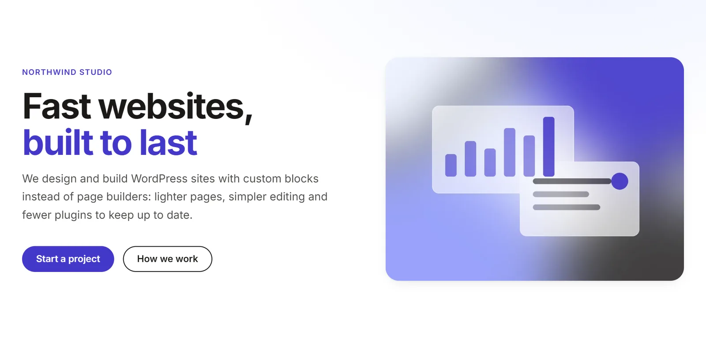
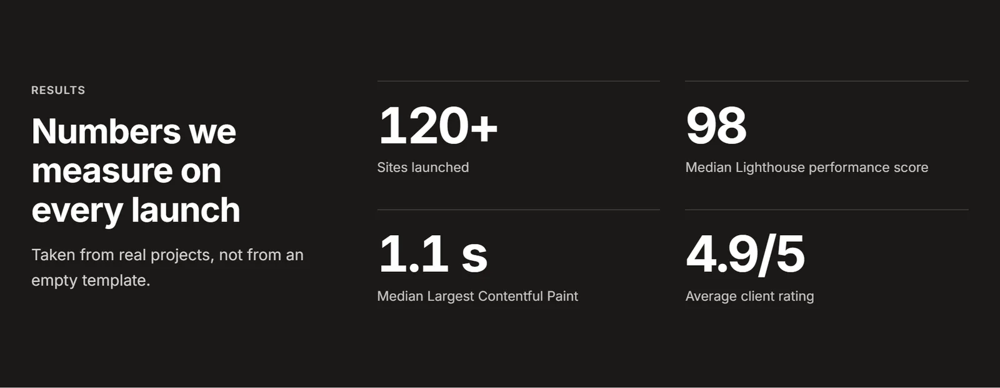
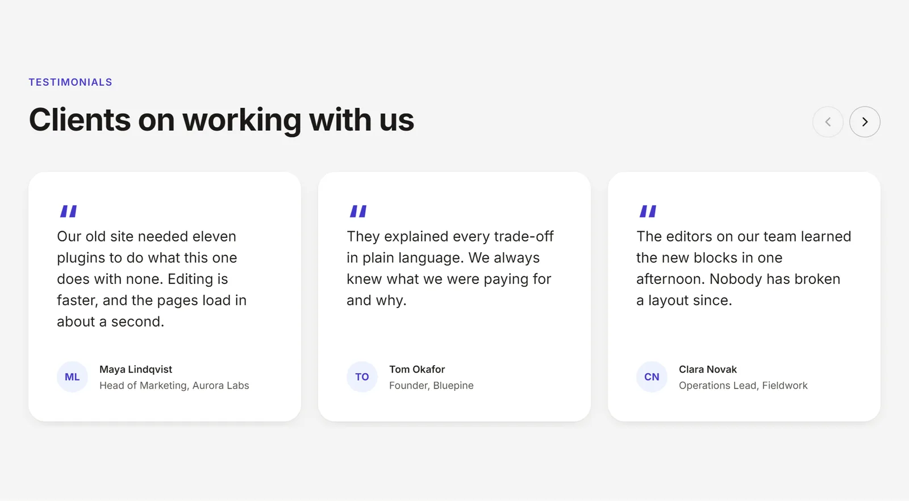
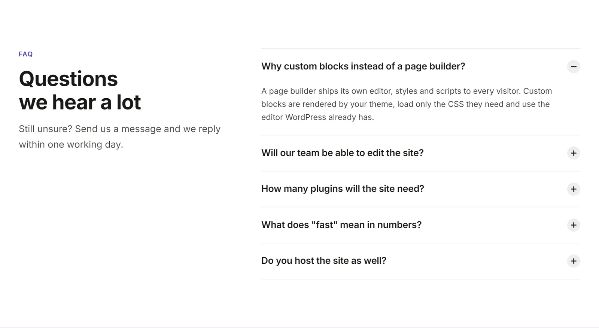
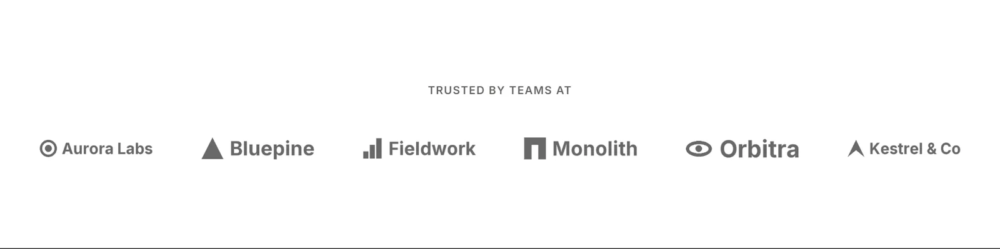
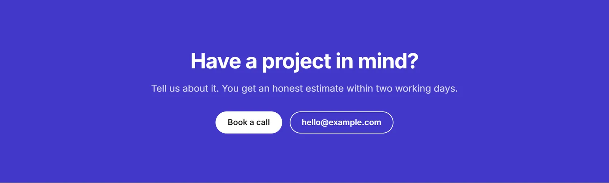
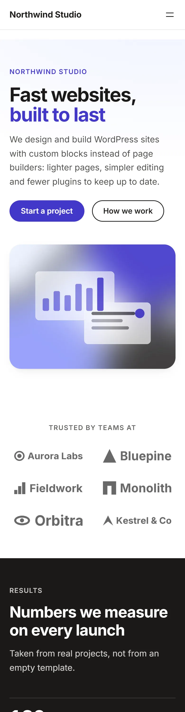
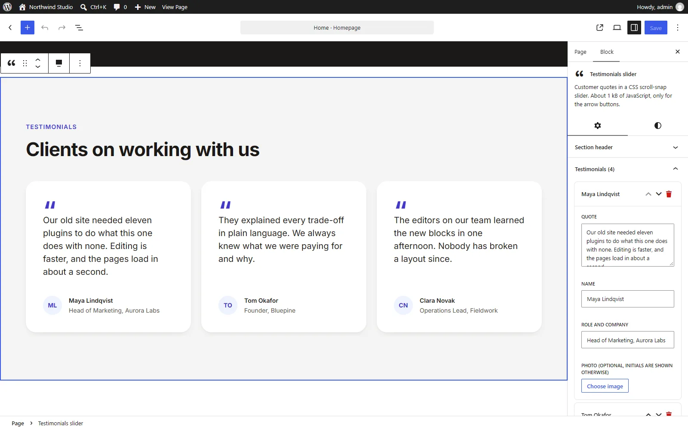

# Lean Block Theme

A WordPress block theme starter with six custom, server-rendered Gutenberg blocks. It needs no page builder and no plugins.



Most marketing sites end up with a page builder, a slider plugin, an accordion plugin and a counter plugin, each loading its own CSS and JavaScript on every page. This theme does the same job with the editor WordPress already has. It shows how I approach block themes: server-rendered blocks, design tokens in one place, and a measured performance budget, packaged as a starter you can fork.

- **Six blocks:** Hero, FAQ, Testimonials slider, Logo strip, Call to action, Stats.
- **One source of design tokens:** `theme.json`. Tailwind CSS v4 reads the CSS variables WordPress generates from it.
- **CSS only where it is used:** every block ships its own stylesheet, and WordPress prints it only on pages that contain the block.
- **1.7 kB of front-end JavaScript in total**, split across two small scripts. The FAQ accordion, logo marquee and slider scrolling are native HTML and CSS.
- **Editor preview = front end:** every block renders through its `render.php`, in the editor too.

## Lighthouse (mobile)

Measured on the local demo site (`demo/setup.php`), median of three runs:

| Performance | Accessibility | Best Practices | SEO |
| :---: | :---: | :---: | :---: |
| **94** | **100** | **100** | **92** |

| FCP | LCP | TBT | CLS | Page weight |
| --- | --- | --- | --- | --- |
| 1.2 s | 3.0 s | 11 ms | 0 | 166 kB, 14 requests |

How it was measured and what limits the score:

- **Setup:** Lighthouse 13.5 in headless Edge, default mobile settings (412×823 viewport, simulated slow 4G, 4× CPU slowdown). WordPress 7.1.3 on PHP 8.3, no page cache, no CDN, no plugins. HTML compressed with gzip, as on any production host.
- **Excluded:** the local server's 200 kB `favicon.ico`, which is not part of the theme.
- **SEO 92:** the only failing audit is the missing meta description. Writing one is the job of an SEO plugin or the editor, not of a theme.
- **Biggest remaining cost: core's Navigation block.** Its mobile overlay menu loads the Interactivity API (40 kB) plus 21 kB of CSS. With the overlay turned off (`"overlayMenu":"never"`), the median is **96**, LCP 2.7 s and page weight 122 kB. I left the core block in because it is what editors expect. A lighter menu block is the obvious next step.
- **Run-to-run variation:** in some runs the simulated LCP drops to about 1.8 s and the score to 99. The tables show the median of the final three runs. The LCP actually observed during a run, without simulated throttling, is about 0.5 s.

What the theme itself sends to the browser:

| Asset | Size | gzip | When |
| --- | ---: | ---: | --- |
| `global.css` (base, components, all utilities) | 6.4 kB | 1.9 kB | every page, printed inline in `<head>` |
| block `style.css` (6 files) | 0.2–2.7 kB each | 0.1–1.0 kB | only with the block, inlined by core |
| `testimonials/view.js` | 0.8 kB | 0.5 kB | only with the block, `defer` |
| `stats/view.js` | 0.9 kB | 0.5 kB | only with the block, `defer` |
| Inter variable font, Latin subset | 48 kB | n/a | every page, `font-display: swap` |

## Blocks

| Block | What it does | Front-end JS |
| --- | --- | --- |
| **Hero** | Headline, lead, two buttons, optional image. The image gets `fetchpriority="high"` because it is usually the LCP element. | none |
| **FAQ** | `<details>`/`<summary>` accordion with an optional one-open-at-a-time mode (`name` attribute). Outputs `FAQPage` structured data. | none |
| **Testimonials slider** | CSS scroll-snap track with arrow buttons. Shows initials when there is no photo. | 0.8 kB |
| **Logo strip** | Grid, or a CSS marquee with a pause toggle (a checkbox and `:has()`, no JavaScript). It stops under `prefers-reduced-motion`. Without an image, a logo is shown as text. | none |
| **Call to action** | Full-width band. Text and buttons flip automatically on dark palette colours. | none |
| **Stats** | Numbers count up when scrolled into view. The final values are in the HTML, so they work without JavaScript and for search engines. | 0.9 kB |

| | |
| --- | --- |
|  |  |
|  |  |
|  |  |

Editing happens in the block sidebar. Lists use one shared repeater with add, remove and reorder, and the canvas shows the server-rendered result:



## How it works

```
src/
  blocks/<slug>/
    block.json     metadata, attributes, supports
    render.php     front-end and editor markup (the only template)
    editor.jsx     sidebar controls + server-rendered preview
    view.js        optional front-end script
    style.css      component CSS for this block only
  editor/          shared editor kit: repeater, image picker, preview, ...
  css/
    tokens.css     Tailwind theme mapped onto theme.json variables
    global.css     base layer, shared components, all utilities
inc/               setup, cleanup, schema, rendering helpers
scripts/build.mjs  the whole build: discovers blocks, runs Vite + Tailwind
build/             compiled output (git-ignored)
```

**Blocks are registered in one call.** The build writes `build/blocks-manifest.php` with the contents of every `block.json`, and `wp_register_block_types_from_metadata_collection()` registers them from that one cached PHP array, without locating and parsing a JSON file per block on every request (WordPress 6.8+).

**One template per block.** `render.php` produces the HTML on the front end and in the editor (through `ServerSideRender`). There is no `save()` markup to keep in sync and no block validation errors after a markup change.

**Tokens come from `theme.json`.** `tokens.css` maps Tailwind's theme onto WordPress' variables with `@theme inline`, so `text-primary` compiles to `color: var(--wp--preset--color--primary)`. Change a colour in `theme.json` or in the Site Editor, and utilities, block CSS and core blocks all follow.

**The build is one script.** `scripts/build.mjs` finds blocks by their `block.json`, compiles the CSS with Vite and `@tailwindcss/vite`, and bundles each script as an IIFE with `@wordpress/*` imports mapped to `window.wp.*`. It writes the `.asset.php` dependency files WordPress reads, and stamps each `block.json` with a content hash as `version` for cache busting. There is no per-block configuration file.

## Decisions worth explaining

These are the things I would want to know before inheriting this code.

1. **All Tailwind utilities go into one global file, not per block.** My first version generated utilities per block, so each block's CSS stayed tiny. It broke layouts: when two block stylesheets both define `sm:grid-cols-3`, the later file's copy overrides the earlier file's `lg:grid-cols-6` at every width, because media-query order only holds inside one file. Now utilities are generated once, in the correct order, from every `render.php`. Block files contain component CSS only.
2. **No Tailwind preflight, and no cascade layers.** Preflight resets the lists, headings and margins of core blocks in post content. Layers backfire too: WordPress prints its styles unlayered, and unlayered CSS beats layered CSS whatever the specificity. Tailwind's own `.text-primary` would lose to `:where(a)` from core.
3. **Block supports are applied once.** The editor preview uses `skipBlockSupportAttributes`, and `useBlockProps()` applies colours and spacing to the editor wrapper. Otherwise backgrounds and margins would be applied twice: on the wrapper and again in the server markup. Requests use POST, because list attributes would otherwise make very long URLs.
4. **The dark tone is calculated, not configured.** A block on a dark palette colour gets `.lean-is-dark`, which flips text and button colours. Dark is decided from the colour's WCAG luminance, in PHP and in the editor, so it stays correct when the palette changes.
5. **FAQ schema goes into Yoast's graph when Yoast is active.** Block themes render the whole template before `wp_head()`, so by the time Yoast builds its JSON-LD the questions are already collected. The theme adds `FAQPage` to Yoast's WebPage node and the questions as `Question` nodes, the same shape as Yoast's own FAQ block. Without Yoast, it prints one standalone `FAQPage`. Several FAQ blocks on a page are merged into one entity. Note that Google now shows FAQ rich results mainly for government and health sites; the markup is still valid schema.org.
6. **The counter cannot shift the layout.** Each number is rendered twice in one grid cell: an invisible copy of the final value reserves the width. Numbers already on screen when the page loads do not animate, so they never flash to zero.
7. **The marquee is accessible.** The duplicated list is `inert` and `aria-hidden`, so keyboard and screen-reader users meet each logo once. A persistent pause toggle meets WCAG 2.2.2; pausing on hover or focus alone does not.
8. **Cleanup removes only what is still relevant.** Recent WordPress versions already add the skip link to `<main>` and dropped the emoji DNS prefetch, so the theme does not repeat that. One trap remains: unhooking `wp_enqueue_emoji_styles` leaves its back-compat hook `print_emoji_styles` behind, which then prints a deprecation notice. `inc/cleanup.php` removes both.

## Getting started

Requirements: WordPress 6.8+, PHP 8.1+, Node 20+.

```bash
cd wp-content/themes
git clone https://github.com/jwywiol/lean-block-theme.git
cd lean-block-theme
npm install
npm run build      # or: npm run dev (rebuilds on change)
```

Activate the theme, then insert the **Landing page** pattern on a page and switch it to the **Landing** template. To recreate the demo site exactly (images, menu, front page):

```bash
wp eval-file wp-content/themes/lean-block-theme/demo/setup.php
```

The CI workflow also builds an installable ZIP (with `build/`, without sources) as an artifact.

### Add a block

1. Create `src/blocks/<slug>/` with `block.json`, `render.php` and `style.css`, plus `editor.jsx` and an optional `view.js`.
2. In `render.php`, use `get_block_wrapper_attributes()` and the helpers from `inc/template-tags.php`: `lean_section_classes()`, `lean_section_header()`, `lean_button_row()`.
3. In `editor.jsx`, register the block with `<ServerPreview>` and the controls from `src/editor`.
4. Run `npm run build`. Nothing else needs registering in PHP or in the build configuration.

### Cleanup and hardening

`inc/cleanup.php` removes emoji scripts, the generator tag, the RSD link and the shortlink. It sends `X-Content-Type-Options`, `X-Frame-Options` and `Referrer-Policy`, blocks anonymous `/wp/v2/users` requests and replaces login errors that reveal which accounts exist. Each feature can be switched off:

```php
add_filter( 'lean_cleanup_features', function ( $features ) {
	$features['security_headers'] = false;
	return $features;
} );
```

Content-Security-Policy, `DISALLOW_FILE_EDIT` and rate limiting are left to `wp-config.php` and the server, where they belong.

## Quality checks

- PHP: WordPress Coding Standards (`phpcs.xml.dist`), clean.
- JavaScript: formatted with `wp-prettier` (`npm run format`).
- Tested in the editor and on the front end with WordPress 7.1.3: block registration, server preview, attribute updates, slider buttons, counters, exclusive accordion, marquee pause from the keyboard, no console errors, CLS 0. Yoast SEO integration was checked with Yoast installed temporarily.
- Independent code review (OpenAI Codex) before release. Its four findings were fixed: list normalisation in the Yoast graph, links without an accessible name, the marquee pause control, and the focus ring on dark backgrounds.

## License

GPL-2.0-or-later, like WordPress. The bundled Inter font is under the SIL Open Font License 1.1 (`assets/fonts/OFL.txt`).

---

## Po polsku

**Lean Block Theme** to startowy motyw blokowy WordPressa z sześcioma własnymi blokami Gutenberga: Hero, FAQ, slider opinii, logotypy partnerów, CTA i liczby. Bloki renderuje PHP, motyw nie korzysta z page buildera ani z wtyczek. Pokazuje moje podejście do motywów blokowych: bloki renderowane po stronie serwera, tokeny w jednym miejscu i zmierzony budżet wydajności.

- **Tokeny:** `theme.json` to jedyne źródło tokenów; Tailwind CSS v4 czyta zmienne, które WordPress z niego generuje.
- **CSS:** każdy blok ma własny plik, ładowany tylko na stronach, na których blok występuje.
- **JavaScript:** cały front-endowy JS to 1,7 kB w dwóch skryptach. FAQ, marquee i przewijanie slidera działają w czystym HTML i CSS.
- **Lighthouse mobile:** Performance 94, Accessibility 100, Best Practices 100, SEO 92, CLS 0. Największy pozostały koszt to menu mobilne core'owego bloku Nawigacja. Szczegóły pomiaru są w sekcji *Lighthouse* wyżej.

Instalacja: `npm install && npm run build` w folderze motywu, potem aktywacja w panelu. Nowy blok to nowy folder w `src/blocks/`; niczego nie trzeba dopisywać w PHP ani w konfiguracji buildu.
